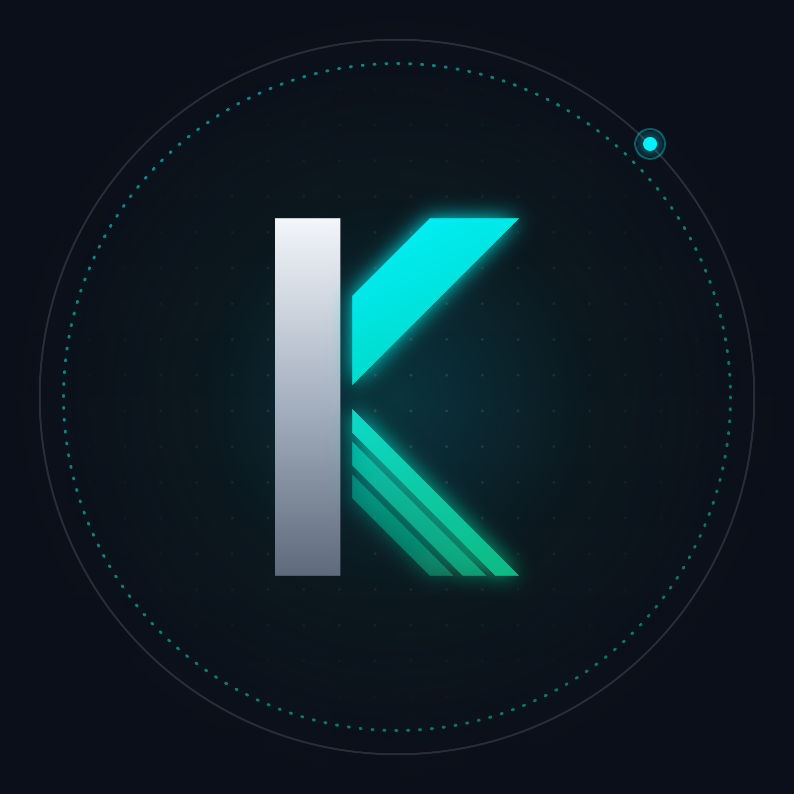

# Kinetix Batch Pay



**Decentralized, Non-Custodial Bulk Payments on Solana**

Kinetix is a powerful, user-friendly platform for sending bulk payments on the Solana blockchain. Whether you are paying salaries, airdropping tokens, or distributing profits, Kinetix allows you to send to hundreds of recipients in a single, efficient batch.

## 🚀 Live Demo

Experience Kinetix live: [kinetix-batch-pay.vercel.app](https://kinetix-batch-pay.vercel.app)

## ✨ Features

- **Bulk Transfers:** Send SOL or SPL Tokens to multiple recipients in one batch.
- **Non-Custodial:** We never hold your funds. You sign every transaction directly from your wallet.
- **Real-time Priority Fees:** Dynamic fee calculation (Eco/Balanced/Turbo) based on live network data.
- **Address Validation:** Real-time validation to prevent sending to invalid or duplicate addresses.
- **Multi-Language Support:** 9 languages including Arabic, English, Chinese, Russian, Spanish, Korean, Japanese, Turkish, and Vietnamese.
- **Responsive Design:** Fully optimized for desktop and mobile.
- **Address Book:** Save your frequent recipients for quick access.
- **Batch History:** Keep track of your recent batches locally.
- **Scheduled Payrolls:** Create recurring payment schedules (local).

## 🛠️ Tech Stack

- **Framework:** Next.js 14 (App Router)
- **Language:** TypeScript
- **Styling:** Tailwind CSS
- **Blockchain:** Solana Web3.js
- **Wallet Integration:** Solana Wallet Adapter
- **Deployment:** Vercel
- **RPC Provider:** Helius

## 🚦 Getting Started

### Prerequisites

- Node.js 18+ installed
- A Solana wallet (Phantom, Solflare, etc.)

### Installation

1. Clone the repository:
   ```bash
   git clone https://github.com/kararard2000-crypto/kinetix-batch-pay.git